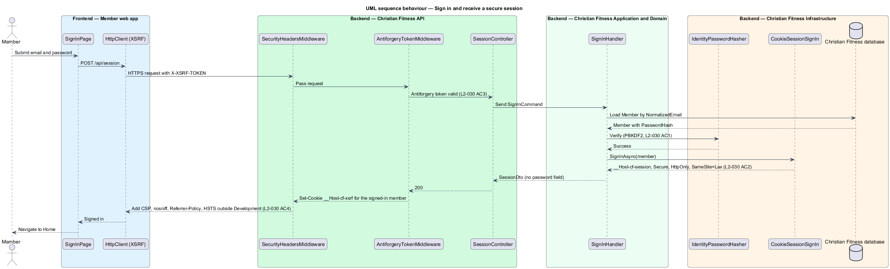
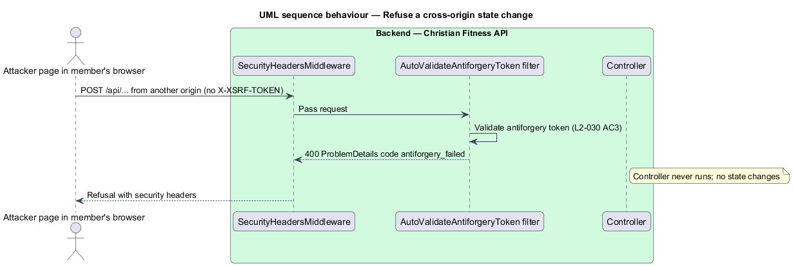

# Secure sessions

## Overview

Christian Fitness holds accounts for members and staff. This feature is the
cross-cutting rule set that protects those accounts at rest and in transit: how a
password is stored, how a session cookie is issued, how a forged cross-site
request is refused, and which security headers accompany each response. It sits
in the security subsystem and applies to every endpoint of the Christian Fitness
API that both the Member web app and the Admin web app call.

- **session cookie** — authentication cookie issued by the Christian Fitness API after a successful sign-in
- **antiforgery token** — per-session value that the API requires on each state-changing request to prove the request originated from a Christian Fitness app
- **security headers** — response headers that instruct the browser to restrict script sources, transport and content sniffing

Sign-in itself (`L2-004`, `L2-018`) is designed in the accounts and admin
subsystems; this design defines the protections those flows rely on.

## Description

The slice runs from the browser's HTTP layer to the password store.

- **`PasswordHasher<Member>`** — ASP.NET Core Identity's PBKDF2 hasher, registered in `ChristianFitness.Infrastructure`. The `Member` entity holds only `PasswordHash`; no handler, DTO or log field carries the clear password.
- **`IPasswordHasherService`** — Application-layer abstraction over the hasher, called by `CreateAccountHandler` and `SignInHandler`.
- **`CookieAuthenticationSetup`** — API extension (`AuthenticationSetup`) that configures cookie authentication: cookie name `__Host-cf-session`, `Secure`, `HttpOnly`, `SameSite=Lax`, path `/`, no `Domain`. `Lax`, not `Strict`, so a member who follows a link to the app from an email or a chat arrives signed in. A member session is persistent for 14 days and slides; idle timeout for admin sessions follows `L2-018` (slice 9.3). An API answers 401 and 403 with a status, never a redirect ([ADR 0007](../../../adr/0007-join-session-and-home-stand-in.md)).
- **`CookieSessionSignIn`** — Infrastructure implementation of the Application's `ISessionSignIn`: it issues the cookie for a member, with a principal that holds only the member id. Join (slice 2.1) calls it the moment the account exists; sign-in (slice 3.1) calls it after the password is verified. `ICurrentMember` reads the member id back from the session.
- **Data Protection keys** — the cookie is protected by ASP.NET Core Data Protection. When `DataProtection__KeysPath` is set the keys persist to that folder, so sessions survive a restart and every instance shares them; unset, they live in memory (`docs/operations/settings.md`).
- **`AntiforgerySetup`** (slice 3.1) — registers ASP.NET Core antiforgery with an HttpOnly, `Secure`, `SameSite=Strict` cookie `__Host-cf-antiforgery` and the `X-XSRF-TOKEN` header. A global `AutoValidateAntiforgeryTokenAttribute` filter refuses each unsafe method (`POST`, `PUT`, `PATCH`, `DELETE`) to a controller without a valid token, anonymous ones (join, sign-in) included; `AntiforgeryRefusalFilter` answers the refusal as a 400 ProblemDetails with code `antiforgery_failed` ([ADR 0009](../../../adr/0009-sign-in-sign-out-and-request-protections.md)).
- **`AntiforgeryTokenMiddleware`** (slice 3.1) — on every `/api/` response, sets the readable token cookie `__Host-cf-xsrf` (`Secure`, not HttpOnly, `SameSite=Strict`, path `/`) for whoever the request ends as. `CookieSessionSignIn` sets the request's user when it signs a member in or out, so join, sign-in and sign-out answer with a token for the new identity. `GET /api/antiforgery` (anonymous, 204) gives a visitor their first token.
- **`SecurityHeadersMiddleware`** (slice 3.1) — API middleware that adds `Content-Security-Policy: default-src 'none'; frame-ancestors 'none'; base-uri 'none'; form-action 'none'` (no script at all, so no `unsafe-inline`), `X-Content-Type-Options: nosniff` and `Referrer-Policy: strict-origin-when-cross-origin` to each response, refusals and errors included. `UseHsts()` adds `Strict-Transport-Security: max-age=31536000; includeSubDomains` outside the Development environment.
- **`HttpClient` XSRF support** — the member app configures `provideHttpClient(withXsrfConfiguration({ cookieName: '__Host-cf-xsrf', headerName: 'X-XSRF-TOKEN' }))` in `app.config.ts`, and `antiforgeryInterceptor` (`domain`) fetches `GET /api/antiforgery` before an unsafe API request when no token cookie can be read, so no component handles the token. The admin app does the same when it gets its client (slice 9.1).
- **Static host headers** — the host serving the built Angular apps sends `nosniff`, the same `Referrer-Policy`, HSTS and a CSP whose `script-src 'self'` has no `unsafe-inline`, as `docs/operations/settings.md` lists. The production build turns off Angular's inline critical CSS, whose `onload` handler that policy blocks. The hosting platform is the deployment journey's choice (L2-041); any host that can set response headers will do.

## Requirements

The feature realizes the following level-2 (L2) requirements. Each L2
requirement refines a level-1 (L1) requirement, cited by identifier. The
specification states these as acceptance criteria rather than one `shall`
sentence, so the criteria are quoted.

| L2 ID | Refines (L1) | Requirement |
|-------|--------------|-------------|
| `L2-030` | `L1-013` | 1. Given any account, when its password is stored, then it is hashed with ASP.NET Core Identity's PBKDF2 hasher and never logged or returned. 2. Given session cookies, when set, then they are `Secure`, `HttpOnly`, `SameSite=Lax` or stricter, and use the `__Host-` prefix. 3. Given a state-changing request from another origin, when it arrives, then it is refused (antiforgery). 4. Given any response, when served, then it carries a Content-Security-Policy without `unsafe-inline` scripts, HSTS in production, `X-Content-Type-Options: nosniff` and `Referrer-Policy: strict-origin-when-cross-origin`. |

## Diagrams

### System context

Members and staff reach Christian Fitness through a browser; every session either app holds is protected by the same rules.

### Containers

Both Angular apps call the Christian Fitness API, which issues the session cookie and stores only password hashes in the Christian Fitness database.

### Components

Inside the API, middleware adds security headers and validates antiforgery tokens before a controller sends any MediatR request; the sign-in handler verifies passwords through the hasher abstraction.

### Class structure

`SignInHandler` and `CreateAccountHandler` depend on `IPasswordHasherService`; `Member` holds a hash only, and the response DTOs carry no password field.

### Behaviour — sign in and receive a secure session

The sign-in handler verifies the password against the PBKDF2 hash; the API then issues a `__Host-` cookie with `Secure`, `HttpOnly` and `SameSite=Lax`, and every response carries the security headers.

### Behaviour — refuse a cross-origin state change

A forged request from another origin carries the browser's session cookie but no valid antiforgery header, so the filter refuses it before any controller runs.

