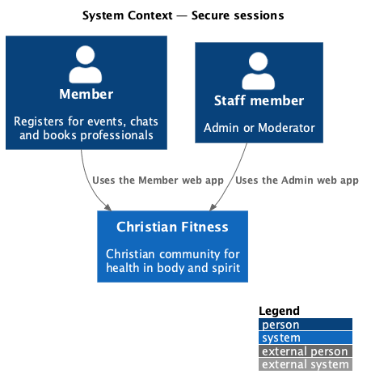
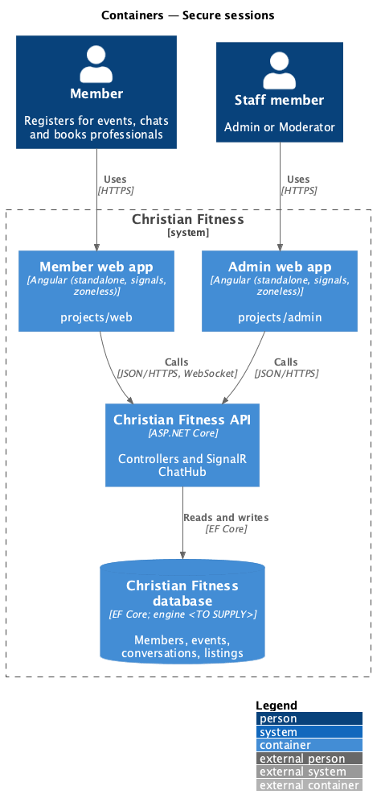
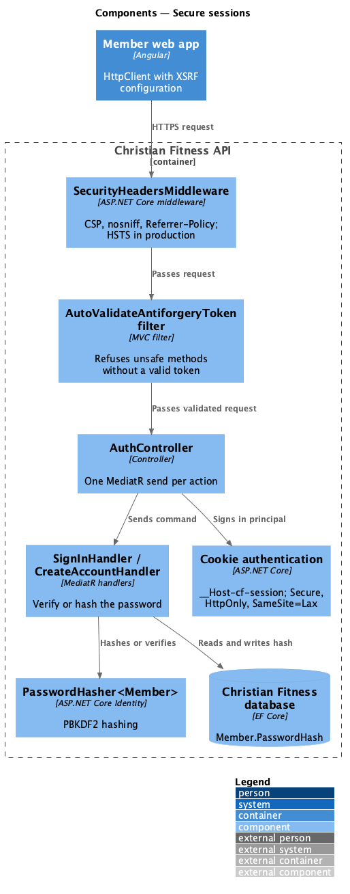
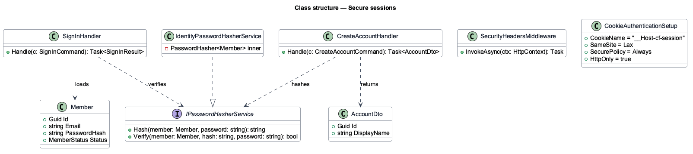

# Secure sessions

## Overview

Christian Fitness holds accounts for members and staff. This feature is the
cross-cutting rule set that protects those accounts at rest and in transit: how a
password is stored, how a session cookie is issued, how a forged cross-site
request is refused, and which security headers accompany each response. It sits
in the security subsystem and applies to every endpoint of the Christian Fitness
API that both the Member web app and the Admin web app call.

- **session cookie** — authentication cookie issued by the Christian Fitness API after a successful sign-in
- **antiforgery token** — per-session value that the API requires on each state-changing request to prove the request originated from a Christian Fitness app
- **security headers** — response headers that instruct the browser to restrict script sources, transport and content sniffing

Sign-in itself (`L2-004`, `L2-018`) is designed in the accounts and admin
subsystems; this design defines the protections those flows rely on.

## Description

The slice runs from the browser's HTTP layer to the password store.

- **`PasswordHasher<Member>`** — ASP.NET Core Identity's PBKDF2 hasher, registered in `ChristianFitness.Infrastructure`. The `Member` entity holds only `PasswordHash`; no handler, DTO or log field carries the clear password.
- **`IPasswordHasherService`** — Application-layer abstraction over the hasher, called by `CreateAccountHandler` and `SignInHandler`.
- **`CookieAuthenticationSetup`** — Infrastructure extension that configures cookie authentication: cookie name `__Host-cf-session`, `Secure`, `HttpOnly`, `SameSite=Lax` (or `Strict`, `<TO SUPPLY>`), path `/`, no `Domain`. Idle timeout for admin sessions follows `L2-018`; the member timeout is `<TO SUPPLY>`.
- **`AntiforgerySetup`** — registers ASP.NET Core antiforgery with a `__Host-` prefixed cookie and an `X-XSRF-TOKEN` header. A global `AutoValidateAntiforgeryTokenAttribute` filter refuses each unsafe method (`POST`, `PUT`, `PATCH`, `DELETE`) without a valid token.
- **`SecurityHeadersMiddleware`** — API middleware that adds `Content-Security-Policy` (no `unsafe-inline` for scripts), `X-Content-Type-Options: nosniff` and `Referrer-Policy: strict-origin-when-cross-origin` to each response. `UseHsts()` adds HSTS in the production environment only.
- **`HttpClient` XSRF support** — both Angular apps configure `provideHttpClient(withXsrfConfiguration({ cookieName, headerName: 'X-XSRF-TOKEN' }))` in `app.config.ts`, so no component handles the token. The exact readable token cookie name is `<TO SUPPLY>`, constrained by the `__Host-` prefix.
- **Static host headers** — the host serving the built Angular apps sends the same CSP and headers; the hosting platform is `<TO SUPPLY>`.

## Requirements

The feature realizes the following level-2 (L2) requirements. Each L2
requirement refines a level-1 (L1) requirement, cited by identifier. The
specification states these as acceptance criteria rather than one `shall`
sentence, so the criteria are quoted.

| L2 ID | Refines (L1) | Requirement |
|-------|--------------|-------------|
| `L2-030` | `L1-013` | 1. Given any account, when its password is stored, then it is hashed with ASP.NET Core Identity's PBKDF2 hasher and never logged or returned. 2. Given session cookies, when set, then they are `Secure`, `HttpOnly`, `SameSite=Lax` or stricter, and use the `__Host-` prefix. 3. Given a state-changing request from another origin, when it arrives, then it is refused (antiforgery). 4. Given any response, when served, then it carries a Content-Security-Policy without `unsafe-inline` scripts, HSTS in production, `X-Content-Type-Options: nosniff` and `Referrer-Policy: strict-origin-when-cross-origin`. |

## Diagrams

### System context

Members and staff reach Christian Fitness through a browser; every session either app holds is protected by the same rules.

### Containers

Both Angular apps call the Christian Fitness API, which issues the session cookie and stores only password hashes in the Christian Fitness database.

### Components

Inside the API, middleware adds security headers and validates antiforgery tokens before a controller sends any MediatR request; the sign-in handler verifies passwords through the hasher abstraction.

### Class structure

`SignInHandler` and `CreateAccountHandler` depend on `IPasswordHasherService`; `Member` holds a hash only, and the response DTOs carry no password field.

### Behaviour — sign in and receive a secure session

The sign-in handler verifies the password against the PBKDF2 hash; the API then issues a `__Host-` cookie with `Secure`, `HttpOnly` and `SameSite=Lax`, and every response carries the security headers.

### Behaviour — refuse a cross-origin state change

A forged request from another origin carries the browser's session cookie but no valid antiforgery header, so the filter refuses it before any controller runs.

