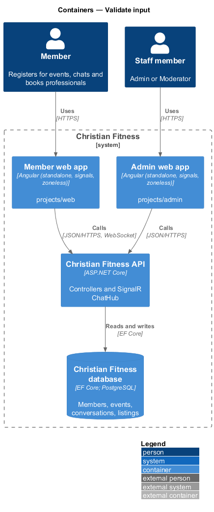
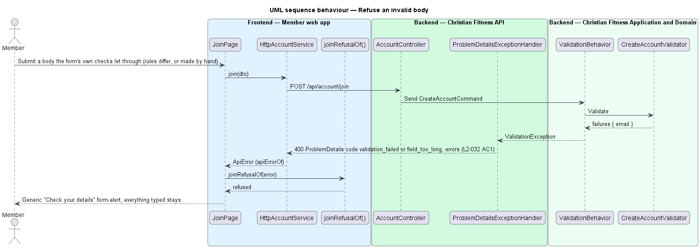

# Validate input

## Overview

Every request body that reaches the Christian Fitness API is untrusted. This
feature defines one path for checking it and one shape for refusing it, so each
screen branches on a stable error `code` and shows a generic message. It also
covers the opposite direction: user-supplied text is always rendered as text,
never interpreted as HTML.

- **ProblemDetails** — RFC 9457 JSON error body; Christian Fitness adds a `code` extension a client branches on
- **field errors** — map from request field name to validation messages, carried in the `errors` member of a 400 response
- **generic message** — fixed, non-technical sentence a screen shows in place of server detail

## Description

- **`XxxValidator`** — one FluentValidation validator per command in `ChristianFitness.Application` (for example `CreateAccountValidator`, `SendMessageValidator`, `SaveEventValidator`).
- **`ValidationBehavior<TRequest,TResponse>`** — MediatR pipeline behaviour that runs every validator for a request before its handler and throws FluentValidation's `ValidationException` with the failures, so the handler is never reached. Slice 2.2 builds it with the first validator, `CreateAccountValidator` ([ADR 0008](../../../adr/0008-join-refusals.md)); slice 1.2 registers MediatR and the validators of `ChristianFitness.Application`.
- **`RefusalException`** — Application exception a handler throws to refuse a request it cannot carry out: a `code` and a `RefusalKind` (`Conflict` for now, answered 409). Slice 2.2's `email_taken` is the first.
- **`ProblemDetailsExceptionHandler`** — `IExceptionHandler` in the API. It maps `ValidationException` to 400 `ValidationProblemDetails` with `code` and `errors` (keyed by the camel-case field name, fixed sentences that never repeat the value); the code is `validation_failed` by default, `field_too_long` when any failure is a length over its limit, or a command-specific code such as `message_invalid`. It maps `RefusalException` to its kind's status and `code`, and any other exception to 500 with title only and code `server_error`. Stack traces and exception messages are never written to the response in any environment, and only the 500 is logged (the exception's type). Slice 1.2 builds the 500 branch; slice 2.2 the 400 and 409 branches.
- **Status-code ProblemDetails** — `AddProblemDetails` with `UseStatusCodePages` gives every bodiless error a ProblemDetails body, and `ProblemCodes.ForStatus` adds its `code`: 401 `unauthenticated`, 403 `forbidden`, 404 `not_found`, 500 `server_error` (`L2-032` AC4).
- **`ApiError`** — DTO in the frontend `api` library: `{ status, code, errors? }`. `HttpXxxService` implementations convert `HttpErrorResponse` to `ApiError` with `apiErrorOf` (`domain`): `code` from the body, else `error`; status 0 (no answer) has code `network`. Slice 2.2's `HttpAccountService` is the first.
- **Screen messages per code** — each screen maps a `code` to its own mock's copy in a pure helper in `domain` with a unit test per row; the first is `joinRefusalOf` (slice 2.2): `email_taken` on the email field, any other 4xx "Check your details" / "Some of your details weren't accepted. Check each field and try again.", a 5xx or no answer "We couldn't create your profile" / "Our servers didn't respond. Everything you typed is still here, so try again in a moment." A screen never shows a server's sentence.
- **Text rendering** — templates bind user text with interpolation (`{{ }}`) or `[textContent]`, never `[innerHTML]`; Angular escapes interpolated text. No lint rule is added: angular-eslint has none for `[innerHTML]`, and a home-made structural check is what AGENTS.md rules out; review keeps the rule and behaviour specs prove it (a name holding markup is greeted as characters, slice 2.2). Fields the form names are shown beside them with `aria-invalid` and `aria-describedby`; the server's field sentences are not shown (`L2-032` AC1).
- **Mock states** — `pages/join/` `invalid` (taken email), `invalid-fields` (the form names each field), `refused` (generic 4xx) and `error` (no answer), and `pages/server-error/`, show the field-error, generic and 500 presentations.

## Requirements

The feature realizes the following level-2 (L2) requirements. Each L2
requirement refines a level-1 (L1) requirement, cited by identifier. The
specification states these as acceptance criteria rather than one `shall`
sentence, so the criteria are quoted.

| L2 ID | Refines (L1) | Requirement |
|-------|--------------|-------------|
| `L2-032` | `L1-013` | 1. Given any request body, when it fails validation, then the API returns 400 ProblemDetails with a `code` and field errors, and the screen shows a generic message. 2. Given an unexpected server error, when it occurs, then the response is a 500 ProblemDetails with no stack trace or internal detail. 3. Given user-supplied text, when rendered anywhere, then it is shown as text, never as HTML. 4. Given any error response (401, 403, 404, 500), when served, then its body is ProblemDetails with a `code` a client can branch on. |

## Diagrams

### System context

Members and staff submit forms through Christian Fitness; the system checks every body it receives.

### Containers

The Christian Fitness API validates request bodies before any handler touches the database; both apps render errors and user text safely.

### Components

The MediatR validation behaviour runs FluentValidation validators ahead of each handler; the exception handler turns failures into ProblemDetails.

### Class structure

`ValidationBehavior` aggregates every `IValidator<TRequest>`; `ProblemDetailsExceptionHandler` maps exception types to status and `code`; the frontend `ApiError` mirrors the response.

### Behaviour — refuse an invalid body

Validators run before the handler; a failure returns 400 with a `code` and field errors, and the screen shows the generic message.

### Behaviour — answer an unexpected error

Any unhandled exception becomes a 500 ProblemDetails that carries a title and trace id only.

### Behaviour — render user text safely

A member's message or name that contains markup is bound by interpolation, so Angular escapes it and the browser shows the characters.

