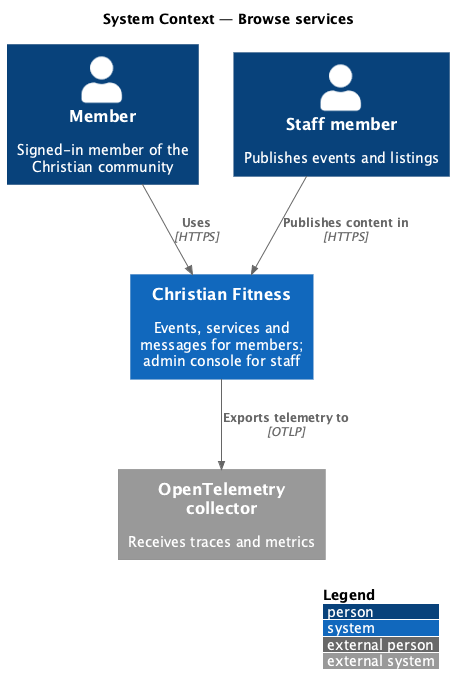
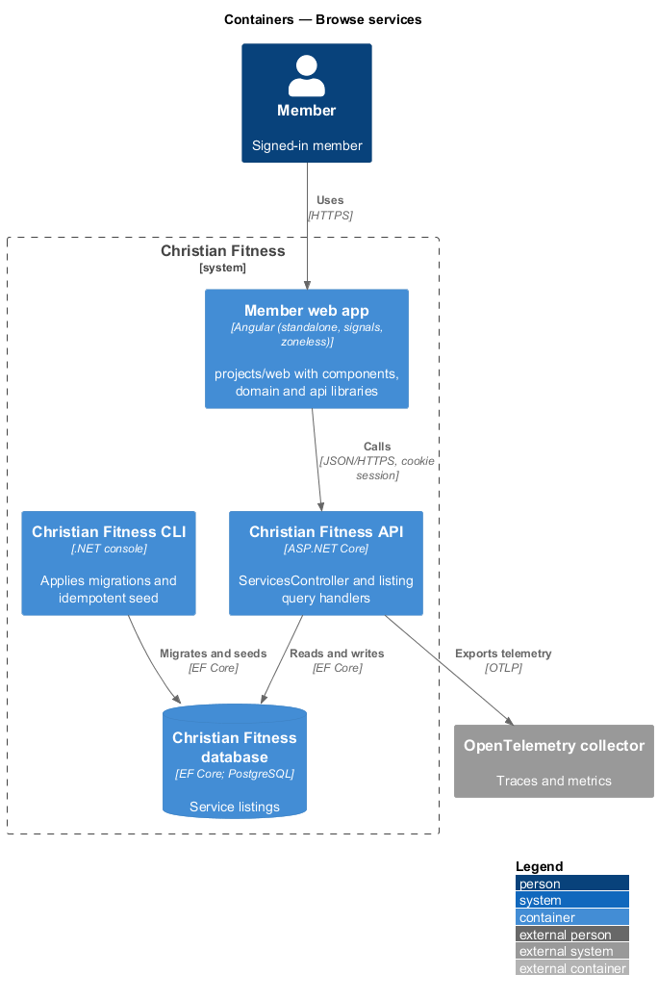
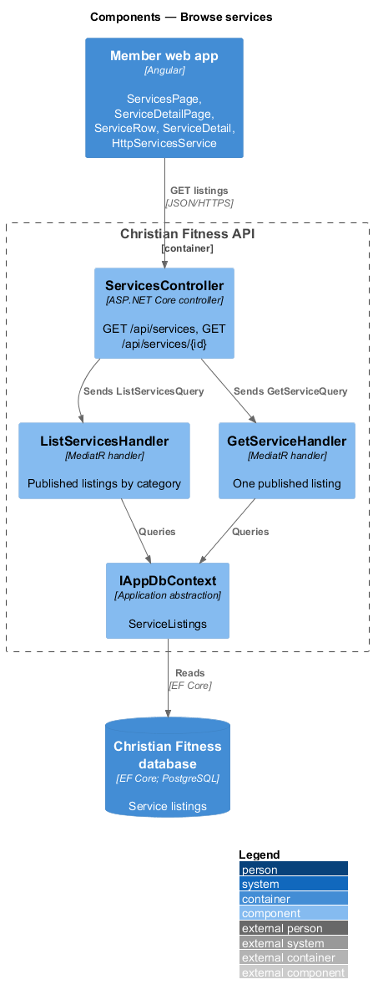
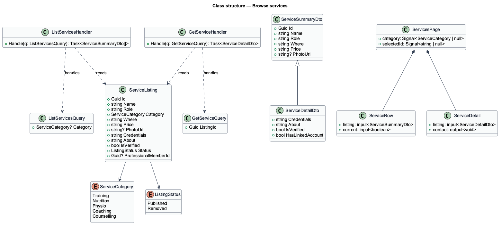
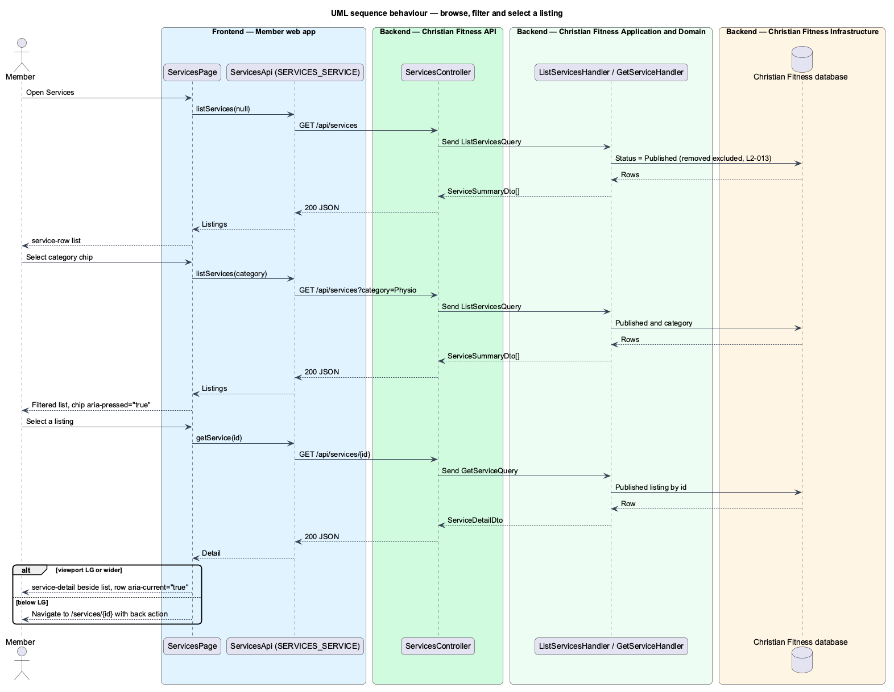

# Browse services

## Overview

Christian Fitness connects members with Christian professionals the team has vetted: trainers, dietitians, physios, coaches and counsellors. A _listing_ is the published profile of one professional, created when staff approve an application. The services subsystem lets members browse listings by category and contact a professional (`L1-006`).

- **listing** — staff-approved, published profile of one professional (`ServiceListing`)
- **service category** — one of Training, Nutrition, Physio, Coaching, Counselling

This feature covers the Services screen (mock `docs/mocks/pages/services/`). It lists published listings, filters them by category, and shows a selected listing's detail. At LG width (>= 992 px, `<TO SUPPLY>` if the design system breakpoint differs) the detail shows beside the list; below LG the detail opens as its own screen with a back action. Listings staff have removed never appear.

- **listing detail** — credentials, about text, verified badge and contact action of one listing

## Description

The feature is a vertical slice from the Services screen to the database.

- **`ServicesPage`** — routed page component at `/services`, loaded with `loadComponent`. It renders the `chip-bar`, the list of `service-row` items and, at LG or wider, a `service-detail` beside the list in a `split` layout. It holds the category and selected id as signals and reflects the selection in the URL (`/services?selected={id}`) so it survives reload.
- **`ServiceDetailPage`** — routed page component at `/services/:id`, used below LG. It renders `ServiceDetail` with a back action to `/services`.
- **`ServiceRow`** — presentation component (block `service-row`). It takes a `ServiceListingSummary` and shows name, role, where, price and avatar or photo; the selected row has `aria-current="true"`.
- **`ServiceDetail`** — presentation component (block `service-detail`, with `spec-list` and `verified`). It shows credentials, about, verified badge and emits the contact action handled in contact-professional (`L2-014`).
- **`ChipBar`** — shared presentation component; each category chip carries `aria-pressed`.
- **`ServicesApi / SERVICES_SERVICE`** — `listServices(category?)` and `getService(id)` in the `api` library.
- **`HttpServicesService`** — calls `GET /api/services?category={category}` and `GET /api/services/{id}`; bound in `app.config.ts`.
- **`ServicesController`** — sends one `ListServicesQuery` or `GetServiceQuery` per request.
- **`ListServicesHandler / GetServiceHandler`** — return listings where `Status == Published`, excluding removed listings, filtered by category. A removed or unknown id yields 404 code `<TO SUPPLY>`.
- **`ServiceListing`** — domain entity with `Name`, `Role`, `Category`, `Where`, `Price`, `PhotoUrl`, `Credentials`, `About`, `IsVerified`, `Status` and an optional `ProfessionalMemberId`.

### Slice 16.1 (ADR 0050)

`GET /api/services?category=` answers `{ total, services }`, name order, at most 50 (no paging), and refuses an unknown category with `category_invalid`. The Services page keeps its state in `?category=` and `?selected=`; below LG the card follows the list in the page, and the separate `/services/:id` screen of `ServiceDetailPage` and `GetServiceHandler` arrive with slice 16.2. The card's contact action arrives with slices 17.1 and 17.2.

### Open questions

- The viewport choice between side-by-side and separate screen is a responsive layout rule; the LG breakpoint value is taken from the design system tokens (`<TO SUPPLY>` if not 992 px).
- `L2-013` names no paging; the number of listings is assumed small. A page size is `<TO SUPPLY>` if listings exceed one screen.
- The error code for a removed or unknown listing id is not specified; `<TO SUPPLY>`.

## Requirements

The feature realizes the following level-2 (L2) requirements. Each L2 requirement refines a level-1 (L1) requirement, cited by identifier. The L2 specification states its requirements as acceptance criteria; the text below condenses those criteria faithfully.

| L2 ID    | Refines (L1) | Requirement                                                                                                                                                                                                                                                                                                                                                                                                                                                                                                                                                         |
| -------- | ------------ | ------------------------------------------------------------------------------------------------------------------------------------------------------------------------------------------------------------------------------------------------------------------------------------------------------------------------------------------------------------------------------------------------------------------------------------------------------------------------------------------------------------------------------------------------------------------- |
| `L2-013` | `L1-006`     | Each published listing on Services shall show name, role, where, price and avatar or photo. Selecting a category (All, Training, Nutrition, Physio, Coaching, Counselling) shall show only matching listings with `aria-pressed="true"` on the category. At LG or wider, a selected listing's detail (credentials, about, verified badge, contact action) shall show beside the list with `aria-current="true"` on the row. Below LG, a selected listing's detail shall open as its own screen with a back action. A listing that staff removed shall not be shown. |

## Diagrams

### System context

A member browses professionals' listings in Christian Fitness; staff approve, edit and remove those listings.

### Containers

The Member web app reads listings from the Christian Fitness API, which reads published listings from the database.

### Components

`ServicesController` sends `ListServicesQuery` or `GetServiceQuery`; the handlers read only published listings through `IAppDbContext`.

### Class structure

`ListServicesHandler` and `GetServiceHandler` project `ServiceListing` into summary and detail DTOs; `ServicesPage` composes `ServiceRow` and `ServiceDetail`.

### Behaviour — browse, filter and select a listing

The page loads published listings and filters by category; selecting a row shows the detail beside the list at LG or wider, or navigates to the detail screen below LG.

