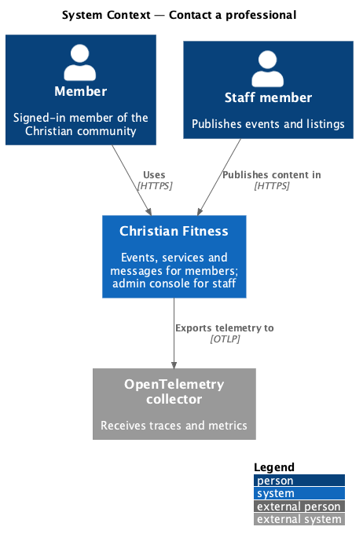
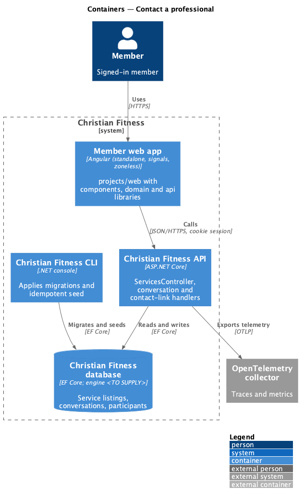
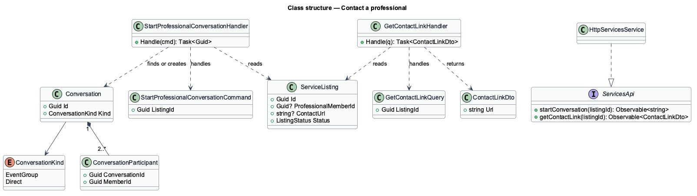
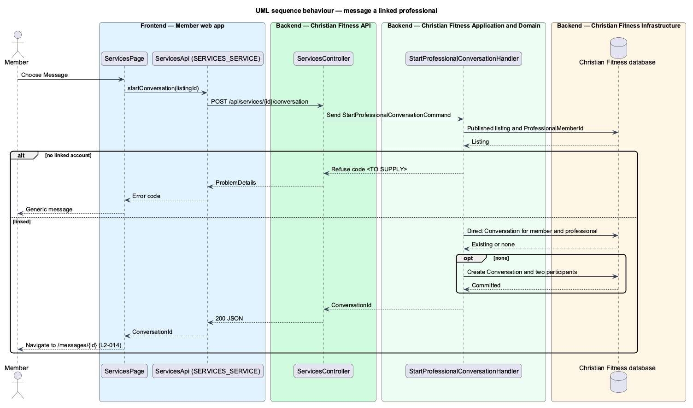
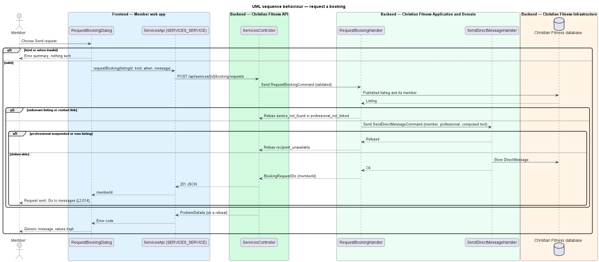

# Contact a professional

## Overview

Christian Fitness connects members with Christian professionals the team has vetted: trainers, dietitians, physios, coaches and counsellors. A _listing_ is the published profile of one professional, created when staff approve an application. The services subsystem lets members browse listings by category and contact a professional (`L1-006`).

- **listing** — staff-approved, published profile of one professional (`ServiceListing`)
- **service category** — one of Training, Nutrition, Physio, Coaching, Counselling

This feature covers the contact action in a listing's detail (mock `docs/mocks/pages/services/selected.html`). When the listing is linked to a professional's account, Message opens a direct conversation with that professional in Messages. When it is not linked, Contact opens the professional's published contact link; the link is not sent to the browser until the member chooses Contact.

ADR 0066 settles the intended listing behaviour: the recipient is the owner, Message on a published,
claimed listing is exempt from the owner's messaging preference, and a listing with no owner hides
Message and refuses a conversation attempt with `listing_unreachable`. Its website or contact is
offered where available. The slice 17.1 behaviour described below is the existing implementation
and must be reconciled with that decision in a later ATDD slice.

- **linked professional account** — member account of the professional that a listing references through `ProfessionalMemberId`
- **direct conversation** — `Conversation` of kind Direct with exactly two participants
- **contact link** — URL the professional published for enquiries

## Description

The feature is a vertical slice from the listing detail to the database.

- **`ServiceDetail`** — presentation component. When `hasLinkedAccount` is true it shows Message; otherwise Contact. It emits a `contact` output and holds no contact detail.
- **`ServicesPage / ServiceDetailPage`** — handle the `contact` output. For Message they call `startConversation(listingId)` and navigate to `/messages/{conversationId}`. For Contact they call `getContactLink(listingId)` and open the returned URL in a new browsing context with `noopener`.
- **`ServicesApi / SERVICES_SERVICE`** — `startConversation(listingId)` returns a conversation id; `getContactLink(listingId)` returns a `ContactLinkDto`.
- **`HttpServicesService`** — calls `POST /api/services/{id}/conversation` and `GET /api/services/{id}/contact-link`.
- **`ServicesController`** — sends one `StartProfessionalConversationCommand` or `GetContactLinkQuery`.
- **`StartProfessionalConversationHandler`** — loads the published listing and its `ProfessionalMemberId`. It returns the existing direct `Conversation` between the member and the professional, or creates one with two `ConversationParticipant` rows. A listing without a linked account is refused with code `professional_not_linked`.
- **`GetContactLinkHandler`** — returns the listing's `ContactUrl` for a published listing. Telemetry records the route template only, never the URL (`L2-040`).

### Decisions (slice 17.1, ADR 0000)

- Request a booking is slice 17.2 (below); the card has Message or Contact only until then.
- The Contact variant has no mock; it is the same secondary button, recorded in ADR 0053.
- A suspended professional or the caller's own listing is refused `recipient_unavailable` (as direct messages, ADR 0043); a suspended caller is refused by the session.
- Codes: `service_not_found` (404), `professional_not_linked` (409), `contact_link_not_found` (404), `recipient_unavailable` (403).
- A listing is linked unless it has a `ContactUrl`; the conversation is the pair, so `startConversation` answers the professional's `memberId` and Messages opens `/messages/{memberId}`.

A professional who also owns a directory listing keeps two records (ADR 0061). The Services detail shows "Also in the directory" to the published listing when the owning member matches or staff linked it (`L2-014` AC6); Message uses the professional's member id, so it opens the same direct conversation as the listing's Message (ADR 0043).

## Requirements

The feature realizes the following level-2 (L2) requirements. Each L2 requirement refines a level-1 (L1) requirement, cited by identifier. The L2 specification states its requirements as acceptance criteria; the text below condenses those criteria faithfully.

| L2 ID    | Refines (L1) | Requirement                                                                                                                                                                                                                                                                                                                                                                                                |
| -------- | ------------ | ---------------------------------------------------------------------------------------------------------------------------------------------------------------------------------------------------------------------------------------------------------------------------------------------------------------------------------------------------------------------------------------------------------- |
| `L2-014` | `L1-006`     | A member may request a booking from a listing; it is delivered as a direct message (AC3 to AC5). For a published listing with an owner, choosing Message shall open a direct conversation with the owner even when "Let anyone message me" is off. An ownerless listing shall hide Message, offer its website or contact where available, and refuse an API conversation attempt with `listing_unreachable`; a contact link shall open when chosen without showing its details beforehand. |

## Diagrams

### System context

A member contacts a professional through Christian Fitness, either by direct message or through the professional's own published contact link outside the system.

### Containers

The Member web app asks the Christian Fitness API for a direct conversation or a contact link; the API reads listings and writes conversations in the database.

### Components

`ServicesController` sends `StartProfessionalConversationCommand` or `GetContactLinkQuery`; the handlers read `ServiceListing` and find or create the direct `Conversation`.

### Class structure

`StartProfessionalConversationHandler` reads `ServiceListing.ProfessionalMemberId` and owns `Conversation` creation; `GetContactLinkHandler` returns a `ContactLinkDto`.

### Behaviour — message a linked professional

The handler finds the existing direct conversation or creates one, and the page navigates to it in Messages.

### Behaviour — open an unlinked professional's contact link

The contact link stays on the server until the member chooses Contact; the page then opens it in a new browsing context.

### Request a booking (slice 17.2, ADR 0054)

- **`ServiceDetail`** shows Request a booking (primary) beside Message for a listing without a contact link, and emits `requestBooking`.
- **`RequestBookingDialog`** (CDK Dialog, mock `docs/mocks/dialogs/request-booking`) holds kind, `when` and message, validates with `validateBooking`, calls `requestBooking(listingId, request)`, and on success offers Done or Go to messages.
- **`POST /api/services/{id}/booking-requests`** sends one `RequestBookingCommand`; `RequestBookingValidator` refuses a bad kind, a blank `when` (400 `validation_failed`) or text over its limit (400 `field_too_long`). `RequestBookingHandler` refuses `service_not_found` (404), `professional_not_linked` (409) and `recipient_unavailable` (403), then sends `SendDirectMessageCommand` (slice 14.1), so the request is a direct message and the conversation starts. Answer 201 `{ memberId }`. Nothing else is stored and the member's words are never logged.

