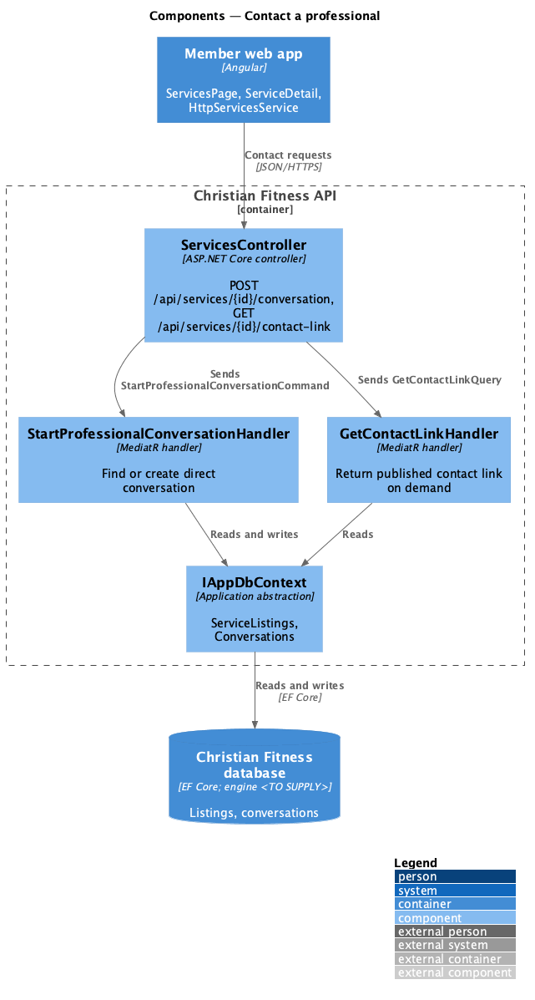
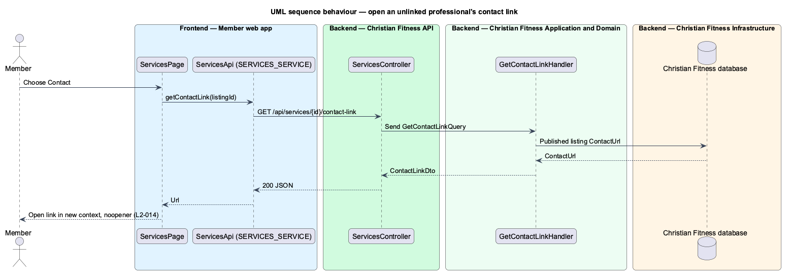

# Contact a professional

## Overview

Christian Fitness connects members with Christian professionals the team has vetted: trainers, dietitians, physios, coaches and counsellors. A *listing* is the published profile of one professional, created when staff approve an application. The services subsystem lets members browse listings by category and contact a professional (`L1-006`).

- **listing** — staff-approved, published profile of one professional (`ServiceListing`)
- **service category** — one of Training, Nutrition, Physio, Coaching, Counselling

This feature covers the contact action in a listing's detail (mock `docs/mocks/pages/services/selected.html`). When the listing is linked to a professional's account, Message opens a direct conversation with that professional in Messages. When it is not linked, Contact opens the professional's published contact link; the link is not sent to the browser until the member chooses Contact.

- **linked professional account** — member account of the professional that a listing references through `ProfessionalMemberId`
- **direct conversation** — `Conversation` of kind Direct with exactly two participants
- **contact link** — URL the professional published for enquiries

## Description

The feature is a vertical slice from the listing detail to the database.

- **`ServiceDetail`** — presentation component. When `hasLinkedAccount` is true it shows Message; otherwise Contact. It emits a `contact` output and holds no contact detail.
- **`ServicesPage / ServiceDetailPage`** — handle the `contact` output. For Message they call `startConversation(listingId)` and navigate to `/messages/{conversationId}`. For Contact they call `getContactLink(listingId)` and open the returned URL in a new browsing context with `noopener`.
- **`ServicesApi / SERVICES_SERVICE`** — `startConversation(listingId)` returns a conversation id; `getContactLink(listingId)` returns a `ContactLinkDto`.
- **`HttpServicesService`** — calls `POST /api/services/{id}/conversation` and `GET /api/services/{id}/contact-link`.
- **`ServicesController`** — sends one `StartProfessionalConversationCommand` or `GetContactLinkQuery`.
- **`StartProfessionalConversationHandler`** — loads the published listing and its `ProfessionalMemberId`. It returns the existing direct `Conversation` between the member and the professional, or creates one with two `ConversationParticipant` rows. A listing without a linked account is refused with code `professional_not_linked`.
- **`GetContactLinkHandler`** — returns the listing's `ContactUrl` for a published listing. Telemetry records the route template only, never the URL (`L2-040`).

### Decisions (slice 17.1, ADR 0052)

- Request a booking is slice 17.2; the card has Message or Contact only.
- The Contact variant has no mock; it is the same secondary button, recorded in ADR 0052.
- A suspended professional or the caller's own listing is refused `recipient_unavailable` (as direct messages, ADR 0043); a suspended caller is refused by the session.
- Codes: `service_not_found` (404), `professional_not_linked` (409), `contact_link_not_found` (404), `recipient_unavailable` (403).
- A listing is linked unless it has a `ContactUrl`; the conversation is the pair, so `startConversation` answers the professional's `memberId` and Messages opens `/messages/{memberId}`.

## Requirements

The feature realizes the following level-2 (L2) requirements. Each L2 requirement refines a level-1 (L1) requirement, cited by identifier. The L2 specification states its requirements as acceptance criteria; the text below condenses those criteria faithfully.

| L2 ID | Refines (L1) | Requirement |
|-------|--------------|-------------|
| `L2-014` | `L1-006` | For a listing with a linked professional account, choosing Message shall open a direct conversation with that professional. For a listing without a linked account, choosing Contact shall open the professional's published contact link; no contact details shall be shown until the member chooses it. |

## Diagrams

### System context

A member contacts a professional through Christian Fitness, either by direct message or through the professional's own published contact link outside the system.

### Containers

The Member web app asks the Christian Fitness API for a direct conversation or a contact link; the API reads listings and writes conversations in the database.

### Components

`ServicesController` sends `StartProfessionalConversationCommand` or `GetContactLinkQuery`; the handlers read `ServiceListing` and find or create the direct `Conversation`.

### Class structure

`StartProfessionalConversationHandler` reads `ServiceListing.ProfessionalMemberId` and owns `Conversation` creation; `GetContactLinkHandler` returns a `ContactLinkDto`.

### Behaviour — message a linked professional

The handler finds the existing direct conversation or creates one, and the page navigates to it in Messages.

### Behaviour — open an unlinked professional's contact link

The contact link stays on the server until the member chooses Contact; the page then opens it in a new browsing context.

